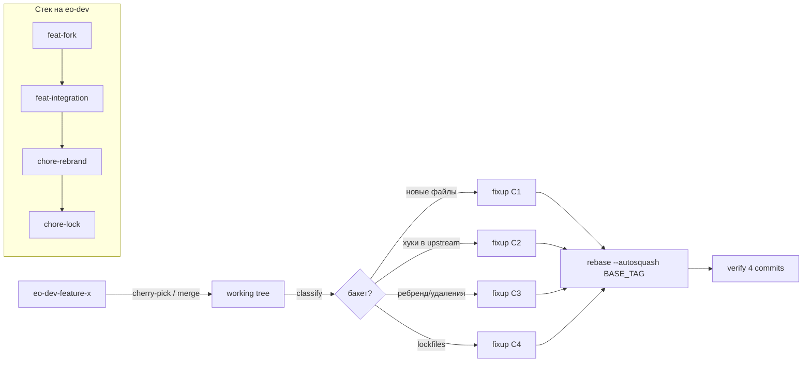

# План: Инкрементальная интеграция фич в 4-слойный форк-стек ExposedObserve

## Проблема

Скилл `fork-commit-prep` описывает полный flatten (`git reset $BASE_TAG`) и перестройку всех 4 коммитов. Для каждой мелкой фичи это избыточно: риск потери работы, долгие hunk-level разборы, повторный прогон всех гейтов.

## Анализ вариантов

| Вариант | Оценка |
|---------|--------|
| **A. Пятый коммит + squash позже** | Нарушает golden rule #2 скилла. Стек «плывёт» между фичами, rebase на новый upstream (`fork-sync`) становится непредсказуемым — он рассчитан на ровно 4 коммита. Отклонён как постоянная схема; допустим только как промежуточный WIP на eo-dev-* ветке. |
| **B. Фичи отдельно, стек при релизе** | Дублирует то, что уже делают eo-dev-* ветки. На релизной границе накапливается большой непроверенный merge — максимальная цена конфликтов именно там, где меньше всего времени. Отклонён. |
| **C. Инкрементальный режим (`git commit --fixup` + autosquash)** | Сохраняет 4-слойную структуру на каждом шаге, трогает только затронутые слои, полностью повторяем. **Выбран.** |
| **D. Другое** | Гибрид C + редкой полной перестройки по триггерам (см. ниже). Именно это и предлагается. |

## Решение: инкрементальный режим (fixup-workflow)

Ключевая идея: новая фича классифицируется по тем же 4 бакетам, но вместо flatten её изменения **дописываются в нужный существующий слой** через `git commit --fixup=<layer>` и `git rebase -i --autosquash $BASE_TAG`. Структура стека не меняется никогда — меняется только содержимое слоёв.

### Диаграмма



### Пошаговая схема (одна фича)

**0. Предусловия**

```bash
git branch --show-current          # eo-dev (не feature-ветка)
BASE_TAG=$(git describe --tags --abbrev=0 --match "v*[0-9]*")
git merge-base --is-ancestor "$BASE_TAG" HEAD || stop
git rev-list --count "$BASE_TAG..HEAD"   # должно быть ровно 4
git status --porcelain             # чисто
git branch -f backup/pre-feature-<name> HEAD   # safety ref
```

**1. Принести фичу из eo-dev-\<feature\>**

Предпочтительно — merge (сохраняет авторство и историю разработки в ветке, но не в стеке):

```bash
git merge --no-commit --squash origin/eo-dev-<feature>
# или, если ветка уже сведена к одному патчу:
git cherry-pick -n <commit>
```

Изменения лежат в working tree, не закоммичены — дальше они классифицируются как в `fork-commit-prep` §2.

**2. Классификация в бакеты (та же, что у скилла)**

- Бакет 1 (`feat(fork)`): новые изолированные fork-файлы (`src/oidc/**`, новые Vue-компоненты фичи, запись в `CHANGELOG.fork.md`).
- Бакет 2 (`feat(integration)`): хуки в upstream-файлах (регистрация роутов, middleware, `mod`, deps в `Cargo.toml`).
- Бакет 3 (`chore(rebrand)`): брендинг/удаления upstream-файлов — у новой фичи обычно пусто.
- Бакет 4 (`chore(lock)`): `Cargo.lock`, `web/package-lock.json`.

Mixed-файл (чаще всего `Cargo.toml`, `src/main.rs`) разбирается hunk-level через `git add -p`, как и в скилле.

**3. Fixup-коммиты в нужные слои**

```bash
git add <bucket-1 files>
git commit --fixup <sha-of-feat(fork)>

git add <bucket-2 files>        # hunk-level при mixed
git commit --fixup <sha-of-feat(integration)>

git add -u                      # rebrand-остаток, если есть
git commit --fixup <sha-of-chore(rebrand)>

git add Cargo.lock web/package-lock.json 2>/dev/null
git commit --fixup <sha-of-chore(lock)>
```

**4. Autosquash**

```bash
GIT_SEQUENCE_EDITOR=: git rebase -i --autosquash "$BASE_TAG"
```

Конфликты возможны только если фича правит те же строки, что и более поздний слой (типичный случай: `Cargo.toml` в слоях 2 и 3). Разрешаются один раз, в порядке слоёв.

**5. Обновление CHANGELOG.fork.md**

- Правится в Бакете 1 (он fork-owned) в том же fixup-коммите, что и новые файлы фичи.
- Запись добавляется в секцию `[Unreleased]` под `### Added` / `### Fixed` / `### Changed` — по типу фичи. Не трогать уже отрезанные релизные секции `eo-v*`.
- Строка baseline (`**Upstream Baseline:**`) обновляется только при `fork-sync`, не при фиче.

**6. Верификация (сокращённая версия §6 скилла)**

```bash
git rev-list --count "$BASE_TAG..HEAD"   # == 4
git diff backup/pre-feature-<name>..HEAD --stat   # только файлы фичи + changelog
git status --porcelain                   # пусто
python3 scripts/check-license-headers.py "$BASE_TAG"
```

Гейты — только затронутые стороны: `cargo fmt --all`, `cargo clippy --workspace --all-targets -- -D warnings` (при Rust-изменениях), `cd web && npm run format:check` (при web-изменениях).

**7. Пуш**

```bash
git fetch origin eo-dev
git push --force-with-lease origin eo-dev
git ls-remote --heads origin eo-dev   # == HEAD
```

## Когда делать ПОЛНУЮ перестройку (fork-commit-prep) вместо инкрементального режима

1. **Смена upstream baseline** — после `fork-sync` стек всегда пересобирается целиком.
2. **Фича меняет границу бакетов** — файл, ранее отнесённый к Бакету 2, получает rebrand-правки (или наоборот), и hunk-level разбор уже существующего коммита проще сделать через flatten.
3. **Накопилось >3–4 инкрементальных фич** — профилактический flatten перед релизом, чтобы перепроверить чистоту бакетов (правило #2 скилла остаётся источником истины).
4. **История fixup-разрешения конфликтов стала запутанной** — дешевле пересобрать, чем аудировать.

## Версионирование (теги eo-v*)

- Тег `eo-v<X.Y.Z>` ставится **только на релиз**, никогда на промежуточное состояние после одной фичи.
- Релизная процедура: инкрементальные фичи накоплены → полный `fork-commit-prep` (перестройка) → все гейты → перенос записей из `[Unreleased]` в новую секцию `## [eo-vX.Y.Z] - YYYY-MM-DD` (в Бакете 1) → `git tag eo-vX.Y.Z` на HEAD стека → обновить compare-ссылки внизу `CHANGELOG.fork.md`.
- Версия патч/минор: patch (`eo-v1.1.3`) для фиксов и мелких фич на том же upstream baseline; bump минора при смене baseline (`fork-sync` на `v1.2.x` → `eo-v1.2.0`).

## Ограничения и подводные камни

1. **`--autosquash` требует чистого rebase**: любой конфликт в раннем слое останавливает rebase и может потребовать разрешения в каждом последующем слое. Митигация: safety-ref `backup/pre-feature-*` перед стартом; при затяжных конфликтах — откат (`git rebase --abort`, reset на backup) и переход к полной перестройке.
2. **Fixup в середину стека переписывает sha всех 4 коммитов** → всегда `--force-with-lease`, никогда голый `--force`; remote eo-dev считается переписываемым, работа других людей на нём — вне схемы.
3. **Fork-owned файлы из Бакета 1 не должны пропасть**: после autosquash повторять проверку из §6.4 скилла (`git cat-file -e HEAD:<file>` по списку fork-owned).
4. **Lockfile-гонки**: если фича трогает `Cargo.toml`, слой 2 и слой 4 меняются вместе; забытый lockfile-апдейт даст расхождение, которое поймает только сборка — поэтому `cargo check` обязателен перед пушем при правках зависимостей.
5. **CHANGELOG — единственный файл, который растёт монотонно**: fixup новых записей в слой 1 безопасен, но при релизной перестройке секции `[Unreleased]` должны переноситься в релизную секцию вручную.
6. **Правило «один стек на один baseline» не отменяется**: инкрементальный режим работает только пока `$BASE_TAG` не изменился.
7. **Смешанные hunks в одном файле** (фича + ребренд одного `Cargo.toml`) — самый хрупкий путь; при первом признаке путаницы — полный flatten.

## Изменение скилла

В `fork-commit-prep` добавить раздел «Incremental mode (feature add-on)» между §1 и §2: условия применимости (ровно 4 коммита на baseline, фича не меняет границы бакетов), шаги 0–7 выше, триггеры отката к полной перестройке. Golden rule #2 дополнить: «единственное исключение — инкрементальный режим с fixup+autosquash; 5+ постоянных коммитов по-прежнему запрещены».

## Шаги реализации

1. Добавить раздел «Incremental mode» в скилл `fork-commit-prep` (`.claude/skills/fork-commit-prep/SKILL.md`).
2. Опционально: скрипт `scripts/fork-add-feature.sh`, автоматизирующий шаги 0, 1, 4, 6 (safety-ref, squash-merge, autosquash, верификация 4 коммитов).
3. Провести пилот на следующей реальной фиче из eo-dev-* и зафиксировать отклонения.
