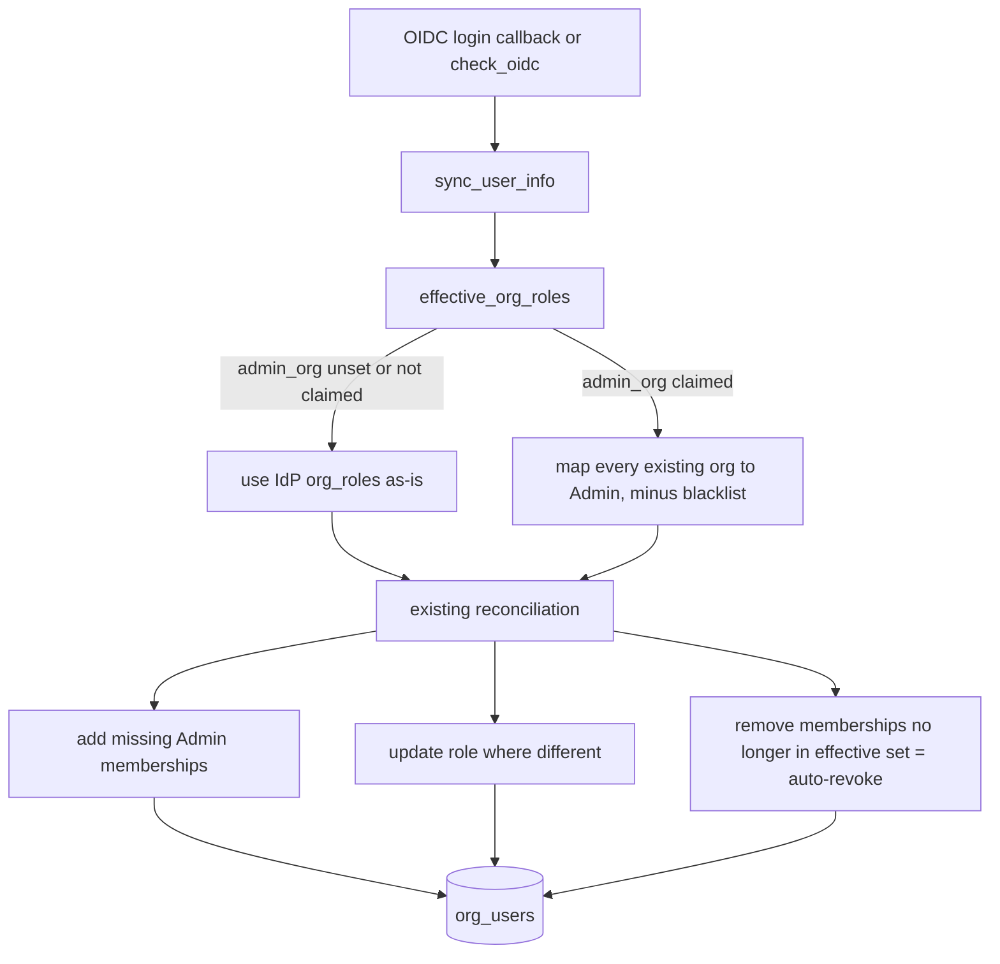

# Feature: OIDC "Admin Organization"

**Status:** approved design (decisions A1 + B1-at-provisioning + C1 + D1)
**Scope:** backend only, OSS `sso` feature path (`src/oidc` crate). No enterprise / Dex / OpenFGA code touched. No frontend changes required (role data flows through existing `#userInfo` bootstrap and org list).

## 1. Goal

When a user logs in via OIDC and the IdP claims membership in a designated "admin organization", that user's effective role is automatically elevated to **Admin** in **all existing organizations**. The elevation is dynamic: it is computed at provisioning time from the IdP claims and materialized through the existing reconciliation, so it is granted when the claim appears and revoked when the claim disappears — with no manual DB surgery.

## 2. Design decisions (locked)

| # | Decision | Choice |
|---|----------|--------|
| A | How the admin org is designated | **A1** — env var `OIDC_ADMIN_ORG` (single org name) on `OidcConfig` |
| B | When/how elevation happens | **B1 at provisioning** — compute effective roles in `sync_user_info`, materialize via existing reconciliation, auto-revoke on claim loss |
| C | Scope of elevation | **C1** — every existing org (auto-create Admin membership where missing) |
| D | Root handling | **D1** — elevation grants `Admin` (level 1) only; `Root` (level 0) stays special and untouched |

### Why B1-at-provisioning and not pure-B1 or pure-B2

- **Pure B1** (only override in `validate_user_info`) fails: the org list (`list_orgs_by_user`), the `#userInfo` bootstrap, and every handler that calls `users::get_user(Some(org), email)` all read the DB, so they would never see the synthetic elevation.
- **Pure B2** (write Admin rows once at login) leaves orphaned Admin rows when the IdP stops claiming admin-org membership — no auto-revoke.
- **B1 at provisioning** gets both: elevation is visible everywhere DB readers look, and revocation is automatic because reconciliation runs on every request.

## 3. Where the change lands (single crate, two files)

### 3.1 Config — `src/oidc/src/config.rs`

Add one optional knob following the existing `OIDC_*` idiom.

- New env constant near the others (lines ~35–68):
  `pub const OIDC_ADMIN_ORG: &str = "OIDC_ADMIN_ORG";`
- New field on `OidcConfig` (struct at line 237):
  `pub admin_org: Option<String>,` — placed right after `default_role` (line 256) to keep role-related knobs together.
- Extend `OidcConfig::new` (signature at line 264): add `admin_org: Option<&str>` parameter, store as `admin_org.map(|s| s.trim().to_owned()).filter(|s| !s.is_empty())`.
- Parse in `load_config_from_env` (line 407), next to `default_role` (line 435):
  `let admin_org = env::var(OIDC_ADMIN_ORG).ok().filter(|s| !s.trim().is_empty());`
  and pass `admin_org.as_deref()` into `OidcConfig::new`.

`admin_org = None` (var unset/empty) must disable the feature entirely — zero behaviour change for existing deployments.

### 3.2 Provisioning — `src/oidc/src/ext_users.rs`

Single behavioural change, inside `sync_user_info` (line 49) before it branches into new/existing user paths.

Introduce a helper that computes the **effective** role map:

```rust
/// The effective per-org roles for this login. When the IdP claims
/// membership in the configured admin org, every existing org is granted
/// `Admin`; otherwise the IdP's own org/role claims are used unchanged.
async fn effective_org_roles(user_info: &UserInfo) -> Result<HashMap<String, String>, AuthError>
```

Logic:
1. If `get_oidc_config().admin_org` is `None`, or `user_info.orgs` does **not** contain the admin org → return `user_info.org_roles.clone()` unchanged.
2. Else list all orgs via `db::organization::list(None)` (returns `Vec<Organization>` with `identifier`/`name`), and build a map `{ every org identifier => "admin" }`, **including** the admin org itself. Skip orgs on the OIDC org blacklist so we never auto-elevate into a blacklisted org.

`sync_user_info` then uses `effective_org_roles(...)` instead of `user_info.org_roles` for both branches:
- new-user path (`check_and_create_user_orgs` at line 176),
- existing-user path (`check_and_update_orgs_users` at line 99).

To keep `role_for_org` (line 83) and `check_and_create_user_orgs` / `check_and_update_orgs_users` working against the effective set without widening their signatures, the cleanest approach is:

- Compute `let effective_roles = effective_org_roles(user_info).await?;`
- Compute `let effective_orgs: HashSet<String> = effective_roles.keys().cloned().collect();`
- Build a shallow adjusted view of `user_info` where `orgs = effective_orgs` and `org_roles = effective_roles` (both fields are `pub` on `UserInfo`, models.rs lines 48–49), and pass that adjusted value down to the existing helpers unchanged.

Because the adjusted `orgs` now equals the effective set, `check_and_update_orgs_users` will:
- **add** the user as Admin in every org they weren't in (line 133 loop),
- **remove** the user from orgs that drop out of the effective set (line 117 loop) — which is exactly the auto-revoke when the admin-org claim disappears.

### Role upgrade for already-member orgs

One subtlety: `check_and_update_orgs_users` only adds/removes memberships; it does **not** update the role of an org the user is already a member of. So a user who is a `Viewer` in org `acme` and gains admin-org membership would stay `Viewer` in `acme`. To honour "elevated to Admin in ALL existing organizations", extend the existing-user branch to also **update the role** when it differs from the effective role:

- In `check_and_update_orgs_users`, inside the loop over `current_orgs` (line 117), for orgs that remain in the effective set: compute `let want = role_for_org(&adjusted, org_name);` and if `org.role != want`, call `db::org_users::update(org_name, email, want, ...)`.
- This makes elevation idempotent and also auto-**demotes** back to the IdP-claimed role when the admin-org claim is lost (since the effective map returns to the IdP's own claims).

## 4. Flow



## 5. Edge cases & invariants

- **Disabled by default:** `OIDC_ADMIN_ORG` unset → `effective_org_roles` returns claims unchanged; zero behaviour change.
- **Blacklist wins:** an org on `OIDC_ORG_BLACKLIST` is never added, even under elevation.
- **Root untouched (D1):** the root user (`ZO_ROOT_USER_EMAIL`) is resolved higher up the stack and never reaches this provisioning path; elevation only ever writes `UserRole::Admin`, never `Root`.
- **Auto-revoke:** when the IdP stops claiming admin-org membership, the effective set shrinks back to the IdP's claims and reconciliation removes/demotes the synthetic Admin rows.
- **Idempotent:** repeated logins with the same claims produce no DB writes after the first.
- **Case sensitivity:** admin-org matching should follow the same convention as org matching elsewhere (`eq_ignore_ascii_case`, see `check_user_in_org` line 43) to avoid a case-mismatch silently disabling the feature.
- **Unknown role safety:** the existing guard in `role_for_org` (unknown claimed role → `User`, never the default) is unchanged and still applies to non-elevated orgs.

## 6. Tests (`src/oidc/src/ext_users.rs` `#[cfg(test)] mod tests`, last item in file)

The existing test module already installs a config via `crate::config::set_config` (see `install_config_with_admin_default` at line 222). Add serial tests (`#[serial]`) covering `effective_org_roles` and `role_for_org` against an adjusted `UserInfo`:

1. Admin org unset → effective map equals input claims.
2. Admin org set + claimed → every listed org maps to `admin`; blacklisted org excluded.
3. Admin org set + not claimed → effective map equals input claims (no elevation).
4. Effective map drives `role_for_org` to return `Admin` for an org the IdP never mentioned.
5. Role-update path: a pre-existing `Viewer` membership in the effective set is reported as needing update to `Admin` (unit-level, asserting the `want` computed by `role_for_org` differs).

## 7. Gates (must pass before done)

- `cargo fmt --all`
- `cargo clippy --workspace --all-targets -- -W clippy::too_many_lines -W clippy::cognitive_complexity -W clippy::excessive_nesting -D warnings`
- `cargo build` (debug; no `--release`)
- `cargo test -p oidc` (or the crate's package name) for the new unit tests.

Comment/style rules: one-line logical comments only; keep type/impl adjacency; `#[cfg(test)] mod tests` stays the last item in `ext_users.rs`.

## 8. Out of scope (follow-ups)

- Frontend: none needed now; the existing org picker already reflects the DB. Optionally surface an "elevated via admin org" badge later.
- Enterprise Dex/OpenFGA path: untouched (`#[cfg(feature = "enterprise")]` not compiled here). If parity is ever required, it must be a paired change in the `o2-enterprise` repo with the same branch name.
- Audit/logging of elevation events beyond the existing `log::info!` lines.
